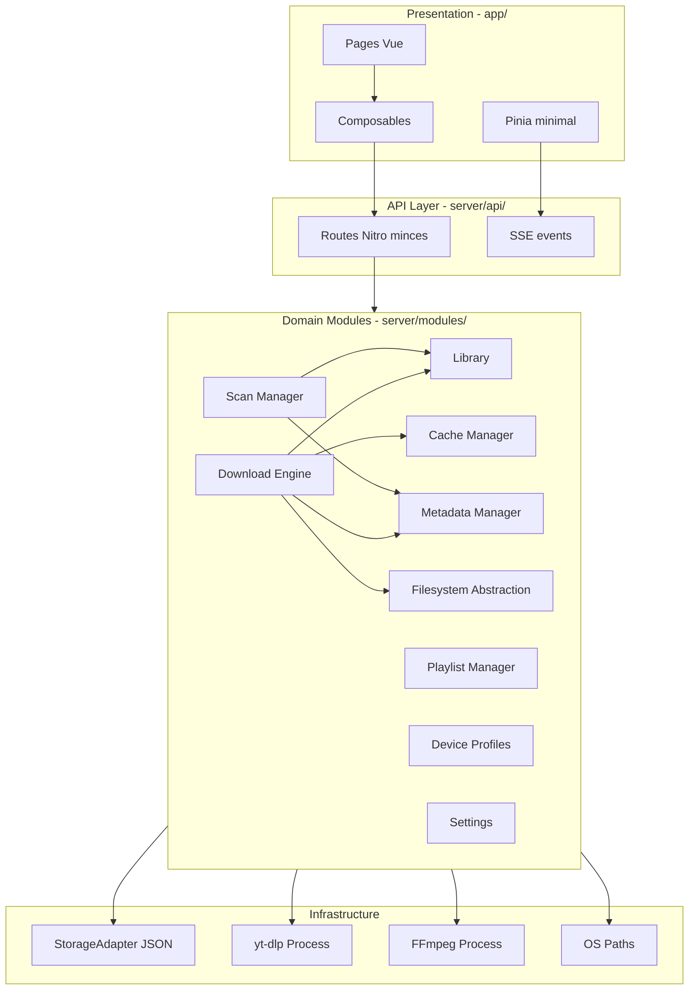
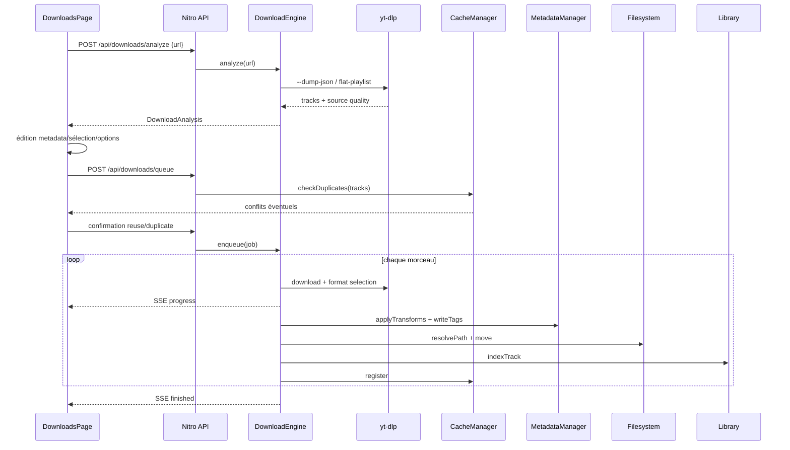

# Architecture Luz — Bibliothèque musicale local-first

## Contexte et principes directeurs

Le dépôt est un **starter Nuxt 4 quasi vide** (`[app/app.vue](app/app.vue)`, `[nuxt.config.ts](nuxt.config.ts)`) avec les dépendances déjà installées (`@nuxt/ui` 4.9.0, `zod`, `sortablejs`, `@vueuse/integrations`) mais **non configurées**. Aucune implémentation métier n'existe encore.

### Décisions architecturales clés


| Décision                    | Choix                                                       | Justification                                                                                                                       |
| --------------------------- | ----------------------------------------------------------- | ----------------------------------------------------------------------------------------------------------------------------------- |
| Source de vérité            | Serveur Nitro (Node)                                        | Fichiers locaux, yt-dlp, FFmpeg — impossibles côté navigateur                                                                       |
| Couplage UI / métier        | Séparation stricte                                          | Pages/composables appellent des API ; modules serveur sans import Vue                                                               |
| Persistance initiale        | JSON + Repository pattern                                   | Simple, inspectable ; `StorageAdapter` permet migration SQLite + Drizzle **si** une DB s'avère nécessaire |
| État temps réel (downloads) | SSE + Pinia minimal                                         | File d'attente multi-jobs avec progression ; Pinia justifié ici                                                                     |
| État bibliothèque           | API + `useFetch` / composables                              | Données persistées serveur ; pas de duplication client inutile                                                                      |
| Layout UI                   | `USidebar` avec `variant="inset"`                         | Composant officiel Nuxt UI 4.9.0 ([doc Sidebar](https://ui.nuxt.com/docs/components/sidebar)) ; pas de `DashboardGroup` pour le shell principal |
| Persistance DB              | JSON uniquement en V1                                     | SQLite + Drizzle **seulement** si une DB devient nécessaire (relations complexes, perfs) ; sinon aucune dépendance DB |
| Métadonnées                 | 4 couches indépendantes                                     | Original / bibliothèque / fichier (tags) / dossiers — transformations configurables par profil                                      |





---

## 1. Architecture modulaire

Chaque module expose une **interface TypeScript** (`shared/domain/`) et une **implémentation serveur** (`server/modules/`). Les modules communiquent via des services injectés, jamais via des imports croisés profonds.

### Modules et responsabilités

- **Download Engine** — Analyse URL (yt-dlp), file d'attente, orchestration des étapes (download → convert → move → index), émission de progression
- **Library** — CRUD artistes/albums/morceaux, vues récentes, statistiques ; source de vérité logique (pas le filesystem)
- **Metadata Manager** — Lecture/écriture tags (music-metadata), règles de transformation (feats, numérotation titre), conservation de l'original
- **Playlist Manager** — Objets logiques, références ordonnées, opérations merge/duplicate/replace
- **Device Profiles** — Profils device (Default read-only + custom), capabilities codecs/formats, defaults download
- **Cache Manager** — Détection doublons (empreinte URL + artiste/titre + hash fichier), politique reuse/duplicate/ask
- **Scan Manager** — Rescan dossiers, détection ajouts/suppressions, sync métadonnées
- **Settings** — Préférences globales UI + liaison profils
- **Filesystem Abstraction** — Résolution chemins selon stratégie d'organisation, move/rename atomiques, vérif espace disque

### Règle de dépendance

```
Presentation → API → Services → Repositories → StorageAdapter
                              → Infrastructure (yt-dlp, ffmpeg, fs)
```

Les modules **Library** et **Playlist** ne dépendent pas de **Download**. C'est **Download** qui appelle Library/Cache/Metadata/FS à la fin du pipeline.

---

## 2. Structure des dossiers

```
Luz/
├── app/
│   ├── app.vue
│   ├── app.config.ts                 # couleurs Nuxt UI (primary red, neutral zinc)
│   ├── assets/css/main.css           # @import tailwindcss + @nuxt/ui + tokens dark
│   ├── layouts/
│   │   └── default.vue               # USidebar variant="inset" shell
│   ├── pages/
│   │   ├── index.vue                 # Accueil
│   │   ├── downloads.vue             # Assistant download
│   │   ├── library/
│   │   │   ├── index.vue
│   │   │   ├── artists/index.vue
│   │   │   ├── artists/[artistId].vue
│   │   │   ├── albums/index.vue
│   │   │   ├── albums/[albumId].vue
│   │   │   ├── tracks/index.vue
│   │   │   └── playlists/
│   │   │       ├── index.vue
│   │   │       └── [playlistId].vue
│   │   └── settings/
│   │       ├── index.vue             # Général + onglets
│   │       ├── profiles/[profileId].vue
│   │       └── system.vue            # Diagnostics
│   ├── components/
│   │   ├── layout/                   # Sidebar, nav, profil footer
│   │   ├── home/
│   │   ├── download/                 # URL input, track list, options panel
│   │   ├── library/                  # Grilles Spotify-like, tables, metadata
│   │   ├── playlist/                 # Drag-drop (sortablejs)
│   │   ├── settings/
│   │   └── shared/                   # Thumbnails, quality badges, danger confirm
│   ├── composables/                  # useDownloadSession, useLibrary, etc.
│   └── stores/
│       ├── ui.ts                     # Pinia : préférences UI client
│       └── downloadQueue.ts          # Pinia : file live + SSE
├── shared/
│   ├── domain/                       # Types + interfaces modules
│   ├── schemas/                      # Schémas Zod (API + validation)
│   └── constants/                    # États download, device types, defaults
├── server/
│   ├── api/                          # Routes minces (validation Zod → service)
│   ├── modules/                      # Logique métier par domaine
│   ├── infrastructure/
│   │   ├── storage/                  # StorageAdapter + JsonStorage uniquement (V1)
│   │   ├── ytdlp/
│   │   ├── ffmpeg/
│   │   └── paths/                    # Data dir, Music/Luz default
│   ├── plugins/
│   │   └── bootstrap.ts              # Init data dir, profil Default, settings
│   └── utils/
└── nuxt.config.ts                    # @nuxt/ui, @pinia/nuxt, alias shared/
```

**Alias Nuxt** : `~/shared` pour types/schemas partagés client/serveur.

---

## 3. Modèles de domaine

### Entités principales

```typescript
// shared/domain/track.ts (extrait conceptuel)
interface Track {
  id: string
  artistId: string
  albumId?: string              // absent pour singles hors album
  playlistIds: string[]         // références multiples
  file: FileInfo                // path, size, codec, bitrate, duration, format
  metadata: MetadataLayers
  source?: SourceInfo           // url, platform, downloadedAt, profileId
  trackNumber?: number
  discNumber?: number
  createdAt: string
  updatedAt: string
}

interface MetadataLayers {
  original: TrackMetadata       // immuable après analyse
  library: TrackMetadata        // affichage bibliothèque
  file: TrackMetadata           // tags embarqués
  folder: { artist: string; album?: string; filename: string }
}

interface TrackMetadata {
  artist: string
  album?: string
  title: string
  trackNumber?: number
  discNumber?: number
  genre?: string
  year?: number
  comment?: string
}
```

**Artist** — `id`, `name`, `sortName`, `imagePath`, `albumIds`, `trackIds`, timestamps

**Album** — `id`, `artistId`, `title`, `type: 'album' | 'single'`, `year`, `genre`, `artworkPath`, `trackIds` (ordre), timestamps

**Playlist** — `id`, `name`, `description?`, `trackIds[]` (ordonné, références uniquement), `type: 'user'`, timestamps

**DeviceProfile** — `id`, `name`, `readOnly`, `deviceType`, `storagePath`, `capabilities` (formats/codecs supportés, préférés, restrictions), `organization` (stratégies dossiers), `metadataRules` (featStrategy, titleNumbering, folderStrategy), `downloadDefaults` (format, qualité, embed cover, etc.)

**CacheEntry** — `fingerprint`, `trackId`, `sourceUrl?`, `fileHash?`, `locations: { albumId?, playlistIds[] }`

**DownloadJob** — `id`, `url`, `status`, `step`, `progress`, `eta?`, `profileId`, `destinationContext`, `tracks: DownloadTrackItem[]`, `options`, `errors[]`, timestamps

### États du pipeline download

`queued` → `analysing` → `waiting_confirmation` → `downloading` → `converting` → `moving` → `updating_library` → `finished`

Terminaux : `cancelled`, `failed`

### DestinationContext (navigation contextuelle)

```typescript
interface DestinationContext {
  type: 'root' | 'artist' | 'album' | 'singles' | 'playlist'
  artistId?: string
  albumId?: string
  playlistId?: string
}
```

Passé en query params : `/downloads?context=artist&artistId=...`

### Stratégies d'organisation filesystem (profil Default, non modifiable v1)


| Type             | Chemin                                                                                   |
| ---------------- | ---------------------------------------------------------------------------------------- |
| Album            | `{storagePath}/{Artist}/{Album}/{filename}`                                              |
| Single           | `{storagePath}/{Artist}/singles/{filename}`                                              |
| Playlist logique | Dossier `{storagePath}/{PlaylistName}/` si fichiers dédiés ; sinon références uniquement |


L'architecture prévoit `OrganizationStrategy` comme interface pour rendre ces règles configurables plus tard.

### Règles métadonnées (ex. profil Default)

- **featStrategy** : feats dans `metadata.file.artist`, absents de `metadata.library.title`
- **titleNumbering** : désactivé par défaut ; si activé, préfixe modifiable + réordonnable drag-drop
- Transformations appliquées par `MetadataTransformer` avant écriture tags et renommage fichier

---

## 4. Flux de données

### Flux principal : téléchargement




### Flux : édition bibliothèque

1. UI modifie métadonnées via `PATCH /api/library/tracks/[trackId]`
2. **LibraryService** met à jour l'entité logique
3. **MetadataManager** recalcule tags fichier si nécessaire
4. **FilesystemService** renomme/déplace si `folder` layers changent
5. **PlaylistManager** / relations artist-album mises à jour
6. Réponse avec entité à jour

### Flux : rescan

1. `POST /api/scan/start` → **ScanManager** parcourt `storagePath` du profil actif
2. Fichiers inconnus → lecture tags → création/mise à jour entités
3. Entités sans fichier → marquées `missing` (pas supprimées auto)
4. Statut via `GET /api/scan/status`

### Flux : navigation Add contextuelle


| Niveau bibliothèque | Action Add                              | Destination downloads |
| ------------------- | --------------------------------------- | --------------------- |
| Racine              | → `/downloads`                          | context root          |
| Artiste             | → `/downloads?context=artist&artistId=` | dossier artiste forcé |
| Album               | → `...&albumId=`                        | artiste + album       |
| Singles             | → `...&context=singles`                 | dossier singles       |
| Playlist            | → `...&context=playlist&playlistId=`    | cible playlist        |


---

## 5. Services (server/modules)


| Service               | Méthodes clés                                                           |
| --------------------- | ----------------------------------------------------------------------- |
| `DownloadService`     | `analyze()`, `enqueue()`, `cancel()`, `getQueue()`, `subscribeEvents()` |
| `YtDlpAnalyzer`       | `extractInfo()`, `listFormats()`, `detectQuality()`                     |
| `YtDlpExecutor`       | `download()`, `extractAudio()` avec callbacks stdout                    |
| `FfmpegService`       | `convert()`, `embedCover()`, `probe()`                                  |
| `LibraryService`      | CRUD + `getRecent()`, `search()`, `reorderTracks()`                     |
| `MetadataService`     | `readTags()`, `writeTags()`, `applyRules()`                             |
| `MetadataTransformer` | `transformFeat()`, `applyNumbering()`, règles profil                    |
| `PlaylistService`     | CRUD + `reorder`, `merge`, `duplicate`, `replace`                       |
| `CacheService`        | `check()`, `register()`, `rebuild()`, politique configurable            |
| `ProfileService`      | CRUD profils (sauf Default), `getActive()`, validation capabilities     |
| `ScanService`         | `start()`, `getStatus()`, `syncMetadata()`                              |
| `SettingsService`     | get/set global + merge profil                                           |
| `FilesystemService`   | `resolveTrackPath()`, `moveAtomic()`, `ensureSpace()`, `listDir()`      |
| `SystemService`       | `getDiagnostics()` — yt-dlp/ffmpeg versions, disk, stats                |


**Orchestrateur download** (`DownloadQueueProcessor`) : worker unique ou pool limité (1-2 concurrent) pour éviter saturation I/O ; état persisté dans `queue.json`.

---

## 6. Pinia — uniquement si justifié

### Store `useUiStore` — JUSTIFIÉ

Préférences purement client (localStorage via `pinia-plugin-persistedstate` ou VueUse `useLocalStorage`) :

- `theme`, `accent` (miroir de `app.config.ts` si besoin)
- `language`, `animations`, `compactMode`, `thumbnailSize`
- `sidebarCollapsed` géré via `v-model:open` sur `USidebar` (pas de cookie Dashboard)

### Store `useDownloadQueueStore` — JUSTIFIÉ

- Abonnement SSE `/api/downloads/events`
- État live : jobs, progress, ETA
- Accessible depuis Downloads, sidebar badge, notifications toast
- Actions : `enqueue`, `cancel`, `retry` (délèguent à l'API)

### Pas de Pinia pour

- Bibliothèque (données serveur, `useLibrary()` composable + `useFetch` avec clés de cache)
- Profil actif (composable `useActiveProfile()` → `GET /api/profiles/active`, cookie serveur)
- Settings (fetch on demand, invalidation après save)

---

## 7. Stratégie de stockage backend

### Emplacement données

```
{dataDir}/                    # défaut : OS Music/Luz/data ou ~/.luz
├── config/
│   ├── settings.json         # préférences globales
│   └── profiles.json         # tous les profils device
├── library/
│   ├── artists.json
│   ├── albums.json
│   ├── tracks.json
│   └── playlists.json
├── cache.json
├── queue.json                # jobs en cours (reprise au redémarrage)
├── download-history.json
└── scan-state.json
```

Fichiers audio : `{profile.storagePath}` (défaut `~/Music/Luz/`)

### Interface StorageAdapter

```typescript
interface StorageAdapter {
  read<T>(collection: string): Promise<T>
  write<T>(collection: string, data: T): Promise<void>
  update<T>(collection: string, fn: (current: T) => T): Promise<T>
  // optionnel, si migration SQLite + Drizzle :
  // query?<T>(...): Promise<T[]>
}
```

- **V1** : `JsonStorageAdapter` — fichiers JSON, verrouillage mutex par collection, écriture atomique (write temp + rename)
- **Si DB nécessaire** (migration future) : SQLite + Drizzle ORM, mêmes repositories ; déclenchée quand les requêtes relationnelles ou le volume de données rendent le JSON inadapté

### Pas de DB en V1

Aucune dépendance `better-sqlite3`, `drizzle-orm` ou équivalent au démarrage. Le `StorageAdapter` reste l'abstraction unique pour permettre une migration sans refonte des modules métier.

### Repositories (un par agrégat)

`ArtistRepository`, `AlbumRepository`, `TrackRepository`, `PlaylistRepository`, `CacheRepository`, `QueueRepository`, `SettingsRepository`, `ProfileRepository`

Les services ne lisent jamais le filesystem JSON directement.

---

## 8. Routes API

### Downloads

- `POST /api/downloads/analyze` — analyse URL, retourne pistes + qualité source
- `GET /api/downloads/queue` — file actuelle
- `POST /api/downloads/queue` — ajouter job(s)
- `PATCH /api/downloads/[jobId]` — confirmer, modifier, pause
- `DELETE /api/downloads/[jobId]` — annuler
- `GET /api/downloads/events` — **SSE** progression

### Library

- `GET /api/library/recent` — artistes, albums, playlists, tracks récents (accueil)
- `GET|POST /api/library/artists` + `GET|PATCH|DELETE /api/library/artists/[artistId]`
- Idem `albums`, `tracks`
- `PATCH /api/library/tracks/[trackId]/reorder` — ordre album/numérotation

### Playlists

- CRUD `/api/playlists` + `[playlistId]`
- `POST /api/playlists/[playlistId]/merge`, `/duplicate`, `/replace`
- `PATCH /api/playlists/[playlistId]/tracks` — réordonnancement

### Cache

- `POST /api/cache/check` — vérification doublons avant download
- `POST /api/cache/rebuild` — danger zone

### Profiles & Settings

- `GET /api/profiles`, `GET /api/profiles/active`, `POST /api/profiles`, `PATCH /api/profiles/[profileId]`
- `GET|PATCH /api/settings`

### Scan & System

- `POST /api/scan/start`, `GET /api/scan/status`
- `GET /api/system/status` — diagnostics complets
- `POST /api/system/actions/[action]` — reset library, clear queue, etc. (danger zone)

Toutes les routes : validation **Zod** via `getValidatedBody` / `getValidatedQuery` (pattern Nuxt 4 h3 v1).

---

## 9. Hiérarchie UI

### Thème et styles (spécification validée)

[`app/assets/css/main.css`](app/assets/css/main.css) :

```css
@import "tailwindcss";
@import "@nuxt/ui";

.dark {
  --ui-bg: var(--ui-color-neutral-950);
  --ui-bg-muted: var(--ui-color-neutral-900);
  --ui-bg-elevated: var(--ui-color-neutral-900);
  --ui-border: var(--ui-color-neutral-900);
  --ui-border-muted: var(--ui-color-neutral-800);
}
```

[`app/app.config.ts`](app/app.config.ts) :

```ts
export default defineAppConfig({
  ui: {
    colors: {
      primary: 'red',
      neutral: 'zinc'
    }
  }
})
```

Référencer `main.css` dans [`nuxt.config.ts`](nuxt.config.ts) via `css: ['~/assets/css/main.css']`.

### Layout principal ([`app/layouts/default.vue`](app/layouts/default.vue))

Pattern officiel `USidebar` + `variant="inset"` (doc Nuxt UI) :

```
div.flex.flex-1.min-h-svh (bg neutral-50 / dark neutral-950 si inset)
├── USidebar (variant="inset", collapsible="icon", rail, v-model:open)
│   ├── #header — logo Luz
│   ├── #default — UNavigationMenu vertical
│   │   ├── Accueil (/)
│   │   ├── Downloads (/downloads)
│   │   ├── Bibliothèque (children expandable)
│   │   │   ├── Artists, Albums, Tracks, Playlists
│   │   └── Settings (/settings)
│   └── #footer — AppProfileFooter (profil device actif, bas gauche)
└── div.flex-1 (zone inset : m-4, rounded-xl, shadow, ring — classes peer-data doc)
    ├── header (h-(--ui-header-height), toggle sidebar, titre page, queue badge)
    └── main — NuxtPage
```

**Note doc Nuxt UI** : `USidebar` est un composant autonome. `UDashboardSidebar` / `UDashboardGroup` sont réservés aux layouts avec resize persisté et panneaux multiples — non utilisés pour le shell principal de Luz.

Props recommandées pour Luz :
- `variant="inset"` — style SidebarInset (contenu encadré avec marge/ombre)
- `collapsible="icon"` — mode Spotify (réduit en icônes)
- `rail` — poignée de toggle sur le bord
- `mode="slideover"` (défaut) — menu mobile

### Page Accueil

- `HomeUrlHero` — input URL + bouton Download → redirect `/downloads?url=`
- `RecentSection` × 4 — grilles horizontales (artistes, albums, playlists, morceaux)

### Page Downloads

Layout responsive flex (pas de `DashboardGroup`) :

```
div.flex.flex-1.gap-4 (colonne sur mobile, row sur lg+)
├── zone principale (flex-1)
│   ├── DownloadUrlInput
│   ├── DownloadDestinationBanner (contexte actif)
│   ├── DownloadTrackList (checkboxes, drag-drop si numbering)
│   └── DownloadQueueBar (jobs en cours)
└── panneau options (w-full lg:w-80 xl:w-96, sticky top)
    └── DownloadOptionsPanel (UCollapsible / UAccordion par groupe)
        ├── Download (format, qualité)
        ├── Metadata (feats, champs)
        ├── Naming (patterns fichier)
        ├── Organization (destination, stratégie)
        ├── Quality (source vs output)
        ├── Device (profil actif)
        └── Advanced (opts yt-dlp)
```

### Page Bibliothèque (style Spotify)

- **Index** : sections + bouton Add → downloads
- **Artist/Album** : header hero (image, titre, stats) + track list + Add
- **Tracks** : `UTable` dense (durée, qualité, taille — détails en slideover)
- **Playlist** : `PlaylistTrackList` sortable, actions context menu

### Page Settings

- Onglets Nuxt UI : Général | Profils | Download defaults | Library | Cache | Danger
- Sous-route `/settings/system` : diagnostics (yt-dlp, ffmpeg, disk, counts, errors log)
- Édition profil : `/settings/profiles/[profileId]`

### Composants partagés clés

- `MediaThumbnail`, `QualityInfo` (source/output), `MetadataEditor` (form réutilisable download + library), `ConfirmDangerAction`, `AddButton`, `EntityContextMenu`

---

## 10. Évolutions futures


| Évolution                             | Préparation architecturale                                            |
| ------------------------------------- | --------------------------------------------------------------------- |
| SQLite + Drizzle                      | `StorageAdapter` + repositories ; migration si JSON insuffisant       |
| Lecteur audio intégré                 | Module `Playback` consommant `Track.file.path` via route stream Nitro |
| Sync Navidrome / Subsonic             | Module `Sync` + profil device type `navidrome`                        |
| Import CSV / Spotify export           | Module `Import` → LibraryService                                      |
| Multi-utilisateur                     | Couche `auth` + isolation dataDir par user                            |
| Organisation dossiers custom          | `OrganizationStrategy` plug-in par profil                             |
| WebSocket bidirectionnel              | Remplacer SSE si contrôle pause/resume plus fin requis                |
| PWA / accès distant                   | Nitro déjà API-ready ; auth + CORS à ajouter                          |
| Watch folder automatique              | ScanManager + chokidar en infrastructure                              |
| Couverture albums automatique         | MetadataManager + téléchargement artwork embed                        |
| File d'attente parallèle configurable | DownloadQueueProcessor pool size dans settings                        |


---

## Dépendances à ajouter (phase implémentation, pas maintenant)

- `@pinia/nuxt` + `pinia`
- `music-metadata` (lecture/écriture tags)
- `nanoid` (IDs)
- Optionnel : `chokidar` (watch folder)
- **Uniquement si migration DB** : `better-sqlite3` + `drizzle-orm` + `drizzle-kit`

## Configuration Nuxt initiale (première tâche d'implémentation)

- Activer `modules: ['@nuxt/ui', '@pinia/nuxt']`
- `css: ['~/assets/css/main.css']`
- [`app/app.config.ts`](app/app.config.ts) — `primary: 'red'`, `neutral: 'zinc'`
- Alias `shared/`
- `runtimeConfig` : `luzDataDir`, chemins yt-dlp/ffmpeg
- Plugin `bootstrap.ts` : création data dir + profil Default

---

## Ordre d'implémentation recommandé (après validation)

1. **Fondations** — config Nuxt, `main.css` + `app.config.ts`, layout `USidebar inset`, types domain, StorageAdapter JSON, bootstrap Default profile
2. **Settings + Profiles** — persistance, page settings squelette
3. **Library vide + Scan** — structure données, rescan
4. **Download analyze** — yt-dlp analyzer, page downloads (analyse + liste)
5. **Download queue + SSE** — pipeline complet jusqu'à indexation
6. **Cache manager** — détection doublons
7. **Metadata editing** — download + library
8. **Playlists** — CRUD + drag-drop
9. **Home recents + diagnostics**
10. **Polish UX** — animations, compact mode, danger zones

